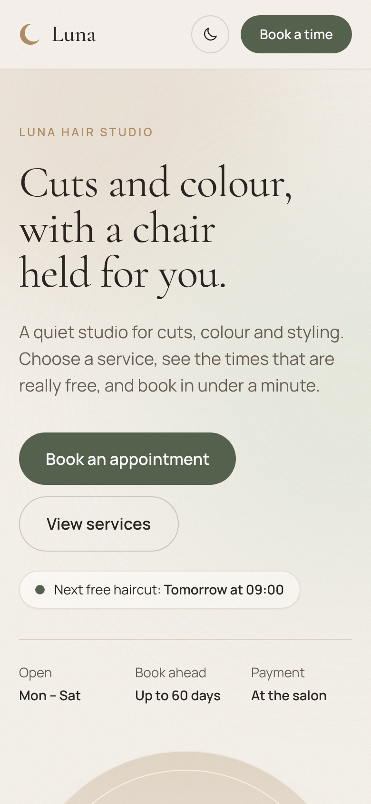
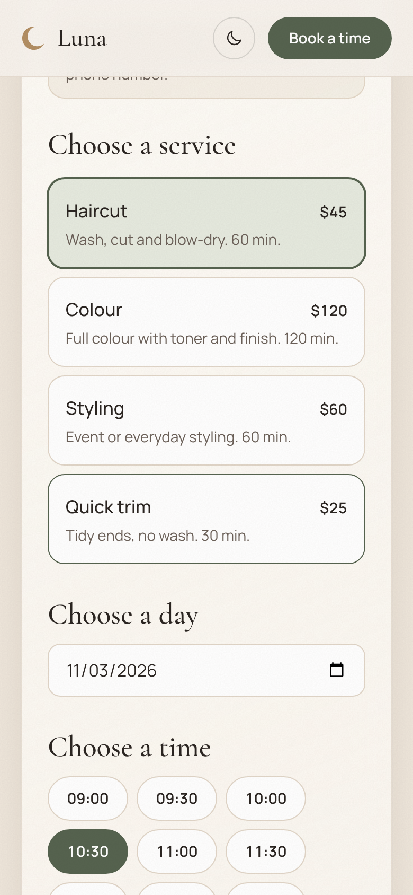
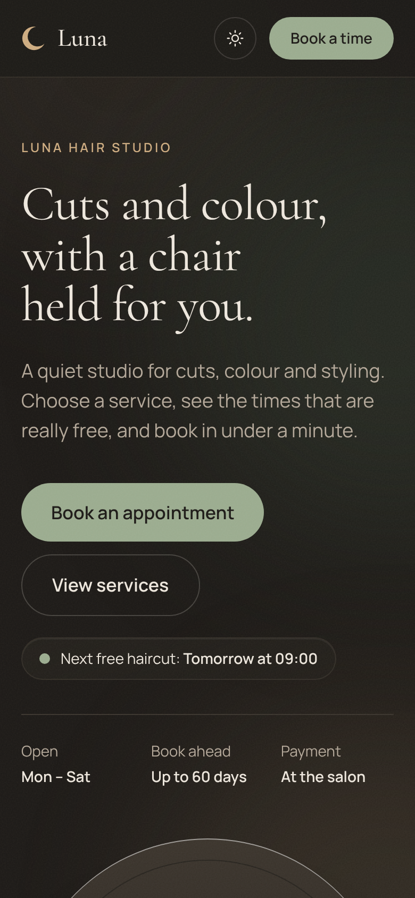
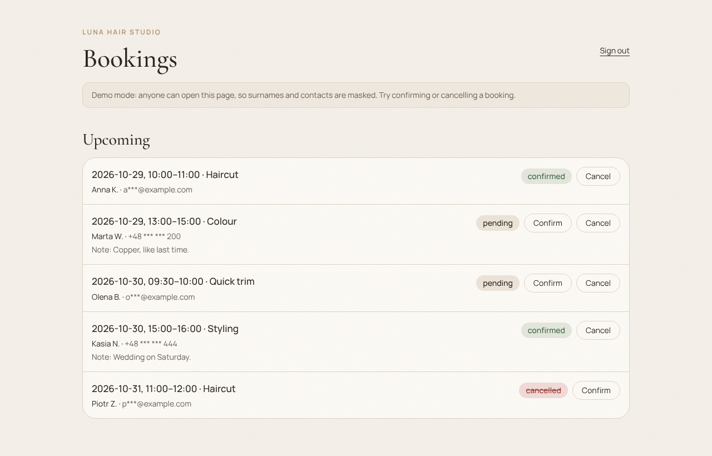

# Luna Hair Studio: online booking for a small salon

[](https://github.com/DanyilShkodiuk/salon-demo/actions/workflows/ci.yml)

**Live demo:** [salon-demo-ruby.vercel.app](https://salon-demo-ruby.vercel.app) · **Admin panel:** [/admin](https://salon-demo-ruby.vercel.app/admin), press **Enter demo admin** (no password needed in the demo)

A website where a salon's customers book an appointment themselves, any time of day, and the owner confirms it with one click. Luna Hair Studio is a sample salon; the names, prices and shades are demo data, and the site is built to be adapted to a real business.

<p>
  
  
  
</p>


## The problem

Most small salons take bookings by phone, Instagram messages or a paper diary. That costs them in three ways:

- **Missed customers.** People want to book in the evening or between meetings, when nobody answers the phone. Many simply book somewhere else.
- **Time lost at the chair.** Every booking is a back-and-forth: "Do you have Thursday?", "What about 4?". The stylist answers it between clients.
- **Double bookings and mistakes.** Two people get the same slot, or a two-hour colour is squeezed into a one-hour gap.

## How the site solves it

**For customers**

- Choose a service and see its price and duration up front.
- Pick a day and see **only the times that are really free**. Closed days, past times and taken slots are hidden, and longer services only show times where they actually fit.
- Leave a name and an email or phone number. No account, no app to install, and it works well on a phone.
- If someone else grabs the same time a second earlier, the customer is told straight away and shown the times that are still free.

**For the salon owner**

- A private, password-protected page with all upcoming and past bookings.
- Confirm or cancel each request with one click. Cancelled times become free again automatically.
- Opening hours, services, prices and durations are set in one place and the whole site follows them.
- Built-in spam protection on the booking form.

## The result

- Customers can book 24/7, so fewer of them are lost outside opening hours.
- The owner stops spending time on booking messages and checks one list instead.
- The calendar cannot be double-booked: the system checks every time slot again at the moment a booking is saved.
- A modern, fast site that also works as the salon's business card online.

## Want something like this for your business?

This works for any business that sells time: hair and beauty salons, barbers, nail studios, massage therapists, tutors, consultants. I can adapt it to your services, brand colours and language, add email or SMS reminders, and put it live on your own domain.

Contact: [Danyil Shkodiuk on GitHub](https://github.com/DanyilShkodiuk)

---

## Коротко українською

Сайт онлайн-запису для невеликого салону краси. Клієнт сам обирає послугу, день і вільний час, без дзвінків і переписок, у будь-який час доби. Власник бачить усі записи на закритій сторінці й підтверджує або скасовує їх одним кліком. Система показує лише справді вільні години і не дає двом клієнтам записатися на один і той самий час. Підходить для салонів, барбершопів, нейл-студій, масажистів, репетиторів і будь-якого бізнесу, що продає час. Можу адаптувати під ваші послуги, стиль і мову.

---

## Technical details

**Stack:** Next.js 15 (App Router, TypeScript), Tailwind CSS 4, Drizzle ORM, Neon Postgres, Zod, Vitest. Hosted on Vercel (Frankfurt region).

### Run locally

```bash
npm install
cp .env.example .env.local   # then fill in ADMIN_PASSWORD and ADMIN_SECRET
npm run dev
```

Without `DATABASE_URL`, development uses an in-memory store (data resets on restart). Production refuses to start without a database.

### Demo mode

Set `DEMO_MODE=true` for a public demo. The admin login page then shows an **Enter demo admin** button instead of the password form, surnames and contacts are masked in the admin list, and sample bookings are added whenever nothing is upcoming. `ADMIN_PASSWORD` and `ADMIN_SECRET` are still required. Leave `DEMO_MODE` empty for a real salon. Visitors can still type anything into the booking note, so keep the demo database separate from real data.

### Connect Neon

1. In the Neon dashboard open your project and click **Connect**. Copy the connection string.
2. Save it without showing it on screen: `npm run db:setup`, paste (nothing appears), press Enter. This writes `DATABASE_URL` to `.env.local`, which is never committed.
3. Create the table: `npm run db:migrate`. Run it again after pulling changes that add files to `drizzle/`.
4. Check the connection: `npm run db:check` (prints whether the table exists and how many bookings it holds)
5. Start the app: `npm run dev`. Bookings now persist across restarts.

### Email notifications

Each new booking emails the owner (with the customer's details and a reply-to set to the customer, when they left an email). If the customer left an email, they also get a short "we received your booking" note. Emails go through [Resend](https://resend.com) and are sent after the response, so a slow or failing mail provider never blocks or breaks a booking.

1. Create a Resend account and an API key.
2. Add to `.env.local` (and to the Vercel project settings): `RESEND_API_KEY`, `NOTIFY_FROM`, `NOTIFY_OWNER_EMAIL`.
3. For a quick test, `NOTIFY_FROM="Luna Hair Studio <onboarding@resend.dev>"` works, but Resend then only delivers to your own account's email. To email customers, verify the salon's domain in Resend and send from it.

With any of the three variables empty, emails are skipped and bookings work as before. With `DEMO_MODE` on, only the owner is emailed, so visitors of the public demo cannot make the salon send email to an address they type.

### Checks

```bash
npm test          # slot logic, validation, auth, emails, and SQL on a real Postgres engine (PGlite)
npm run typecheck
npm run build
```

GitHub Actions runs the same three checks on every pull request and every push to `main`.

### How double booking is prevented

The API re-checks the chosen time on submit, then inserts with a single SQL statement that only succeeds if no active booking overlaps. If two people submit the same time at once, the second gets a 409 and sees fresh times. Underneath, a Postgres exclusion constraint (`bookings_no_overlap`, migration `0001`) refuses any two active bookings on the same date whose times overlap, so even a perfectly timed race or a manual insert cannot create a double booking.

### Configuration

Salon name, timezone, opening hours, slot step, booking window and the service list live in `src/lib/config.ts`. Colour tokens live in `src/app/globals.css`. Replace the sample shades in `src/components/ShadeCard.tsx` and add real photos when the salon has them.

### Design notes

Style: calm, editorial minimalism with plenty of white space. Palette: warm cream `#f7f3ed` and sand `#efe7dc` surfaces, espresso ink `#2b2521`, muted sage `#56634f` for calls to action and the selected time, with a soft gold `#b38f63` for small accents. Fonts: Cormorant Garamond for headings and Manrope for text (both variable, self-hosted via `@fontsource-variable`). Both cover Latin, Latin Extended (Polish) and Cyrillic (Ukrainian), so the site is ready for localisation. A dark theme follows the visitor's system setting, and a button in the header switches it by hand (the choice is remembered on the device). The page tells the (invented) story of the salon and shows off a few interactive pieces: a live "next free time" badge that asks the booking API, numbers that count up on scroll, a two-question service finder that picks the service in the booking form, a team section, reviews, an FAQ and a hand-drawn SVG map. Brand copy lives in `src/lib/brand.ts`, so a real salon's story can replace it in one place. The services section is a 3D carousel: the cards stand on a ring, the chosen one in front and its neighbours turned away into the background. It turns on its own every few seconds, pauses on hover or focus, has a stop button, and stays still for visitors who ask their system for reduced motion.

### Not included yet

The client project brief form with AI planning, and the Cloudflare deployment config are the next stages.
